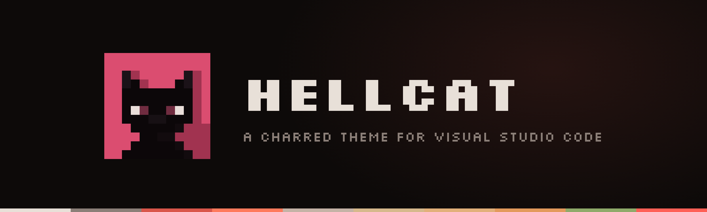
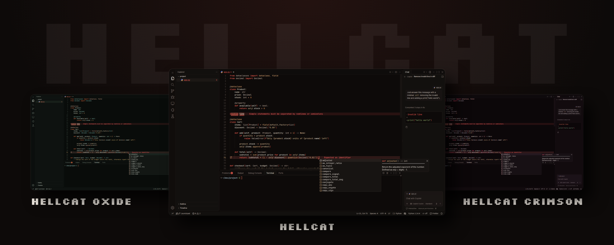
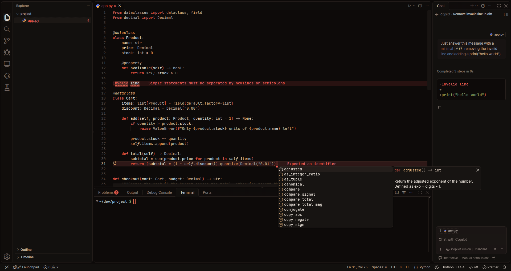
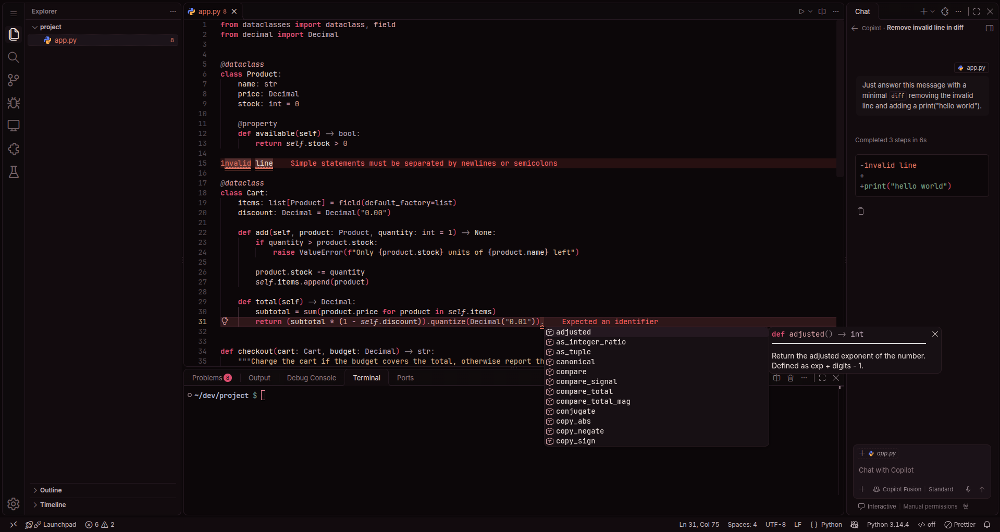
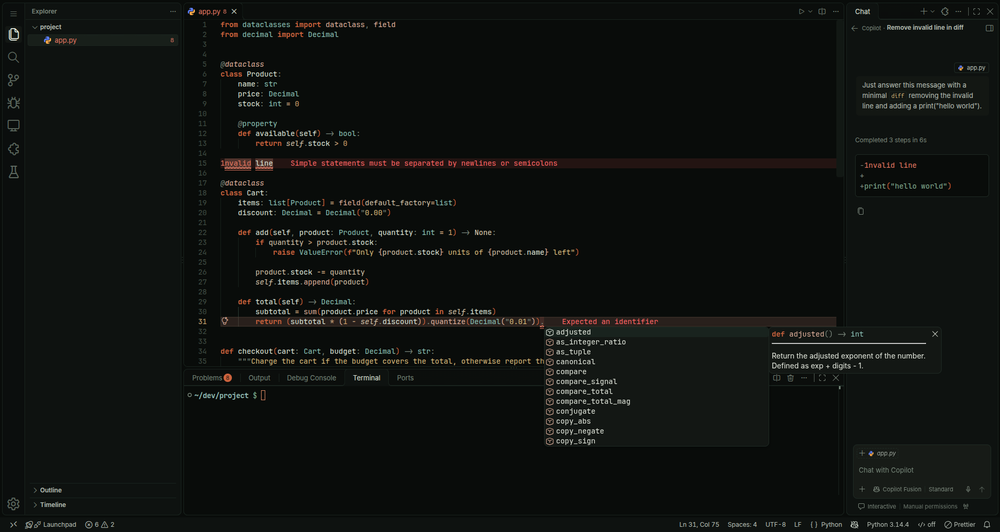
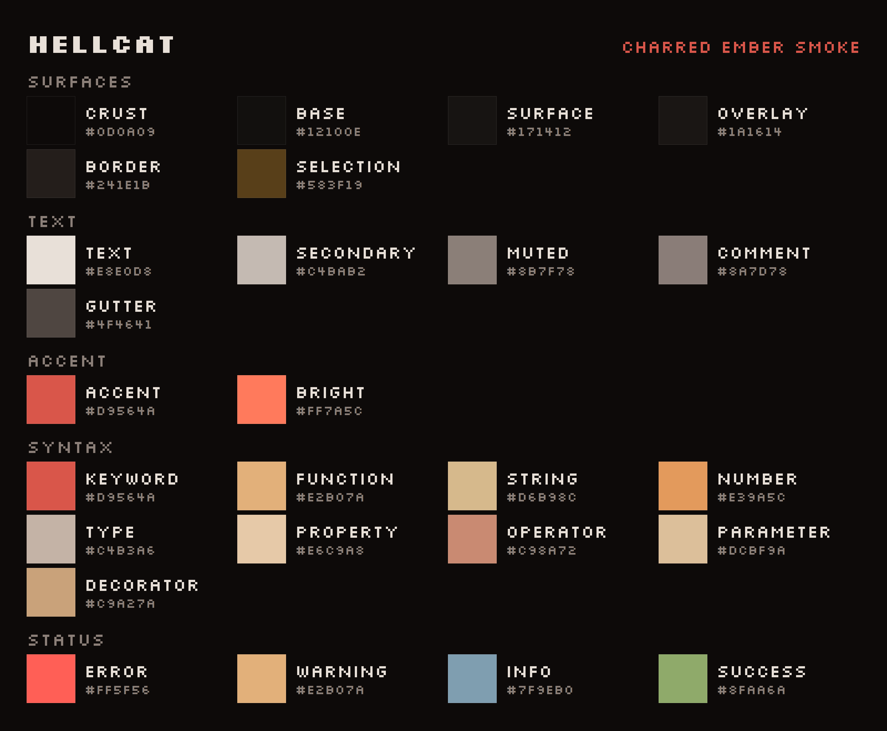
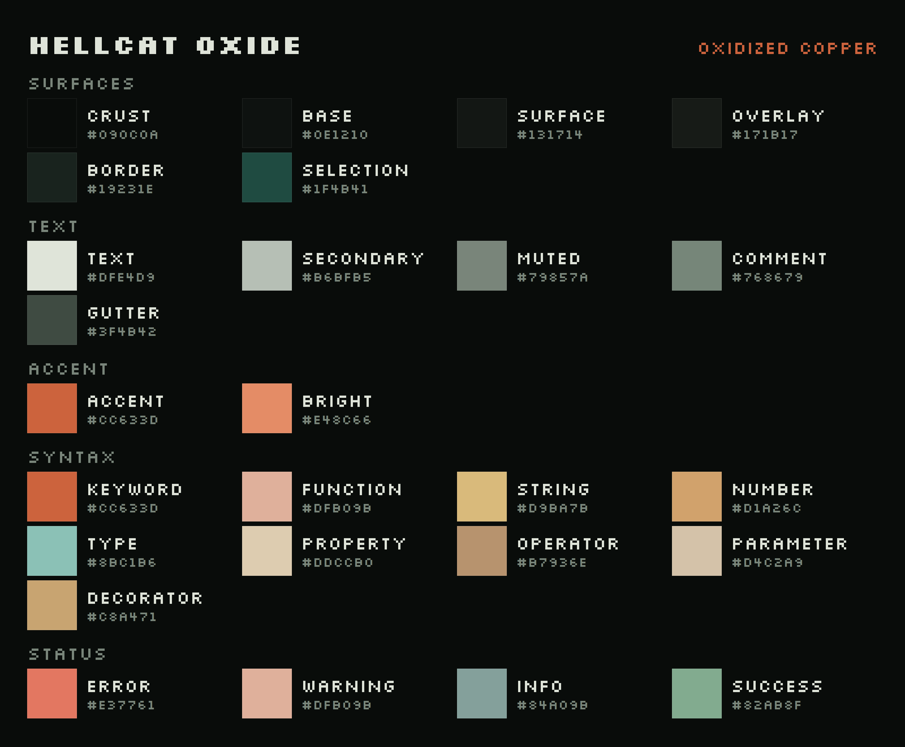
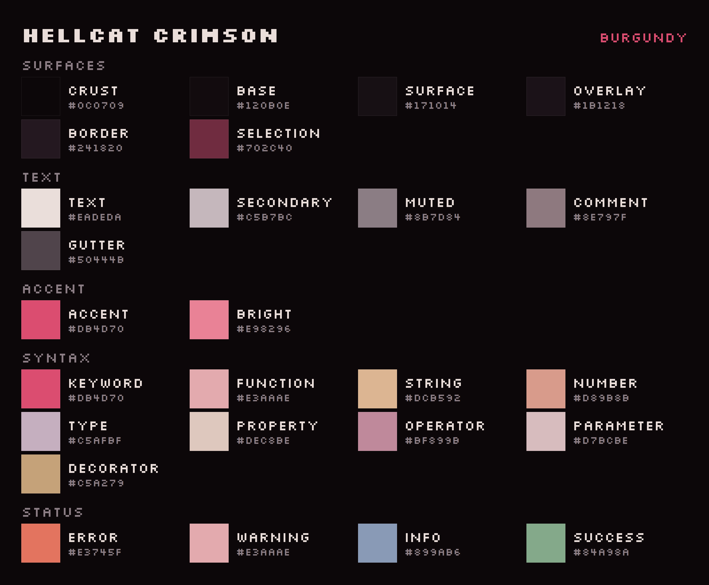

Hellcat is a charred gruvbox-inspired theme in three variants: `Hellcat` (neutral gray), `Hellcat Crimson` (reddish undertones), and `Hellcat Oxide` (greenish undertones).

This theme aims to keep gruvbox's warmth on near-black surfaces, with muted accents and contrast tuned the same across all three variants.

## Preview

Hellcat

Hellcat Crimson

Hellcat Oxide

## Install

Hellcat installs from the [Visual Studio Code Marketplace](https://marketplace.visualstudio.com/items?itemName=SirCesarium.hellcat-theme).

1. Open the Extensions view with `Ctrl+Shift+X`.
2. Search for `Hellcat` and install the extension.
3. Run "Preferences: Color Theme" with `Ctrl+K Ctrl+T`, type `Hellcat`, and pick a variant.

## Variants

| Theme | Vibe | Background | Accent |
| --- | --- | --- | --- |
| Hellcat | Neutral gray |  |  |
| Hellcat Crimson | Reddish |  |  |
| Hellcat Oxide | Greenish |  |  |

## Palette

Every role and hex value is in [PALETTE.md](PALETTE.md).

## License

This project is licensed under the MIT license. See [LICENSE](./LICENSE) for details.
